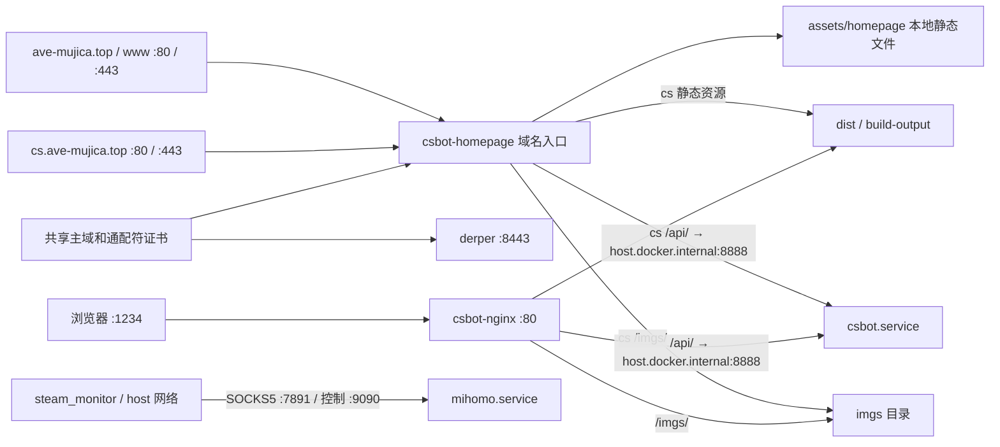

# CSBot 服务器服务清单

## 2026-10-24 赛事自动监视上线

- 按用户授权发布后端赛事自动监视：16:13 从 `3e04365739e47d855897343d5efa8e9c3ba3665a` 经 GitHub `pull --ff-only` 更新到 `2fc2655d5a7e36a8e9ac71237d0f3135331a6475` 并重启；随后发布日志修复 `e8bbf53d1c70670044b4a348476708b2cfd059e8`，再发布错峰调度 `f523ed487ef8f5aaf3a3de2c1b9f349fdbdfbc50` 并重启。最终 MainPID `602461`、`NRestarts=0`、active，插件加载成功，启动日志无错误。
- 结果抓取已从“每 5 分钟一次性抓完所有进行中赛事”改为每分钟调度、按赛事错峰：每赛事约 5 分钟一轮，首次/重启后偏移 30–290 秒，单分钟最多 2 个赛事、2 秒间隔。16:32:00、16:38:00、16:44:00 各抓取一次 8050，按约 5–6 分钟错开；16:46:00 自然调度再次刷新列表（6 个赛事，1 个进行中）。单元测试用 4 个进行中赛事验证各分钟只触发 1 个请求。
- 16:15:00 自然调度首次自动刷新监视列表，选中 `PGL 布加勒斯特大师赛 2026(8050)`、`MESA Pro 2026 万圣节杯(9462)`、`RLG特斯拉杯 2026(9434)`、`HyperX Retake 第13赛季(9427)`、`IEM 北京 2026(8245)`、`BLAST 对抗赛 2026 S2(8251)`。数据库 `runtime_config.hltv_event_id_list=[8050,9462,9434,9427,8245,8251]`、`updated_by=auto`；`hltv_followed_teams=["TYLOO","LVG","FaZe","BC.Game"]`；`local_storage.hltv_discovery_failures=0`。
- 最终验收：后端回环探测 HTTP 404（服务已响应）、前端 HTTPS 200、`csbot.service` active/NRestarts=0、重启后无 error 级日志。前端 `dist`、Steam Monitor、Compose、数据库结构和依赖均未改动；未生成迁移，未发送 QQ 测试消息。

## 2026-10-23 安全更新与公网入口收敛

- 已按用户授权完成生产更新及一次整机重启。后端版本 `3e04365739e47d855897343d5efa8e9c3ba3665a`，Steam Monitor `a14cb91886765f48b124d42e250834e655ddfdf1`，均经 GitHub 推送和服务器 `pull --ff-only` 发布。前端产物保持 `46631aa299731c0f09c34a83ec0b755f085ddc4e`，本轮未修改前端源码或构建。
- 实际运行版本：内核 `5.15.0-198-generic`（包 `5.15.0-198.208`），OpenSSH `1:8.9p1-3ubuntu0.18`，OpenSSL `3.0.2-0ubuntu1.30`，Docker `29.9.2`、runc `1.5.2`；两处 Nginx `1.30.6`，PostgreSQL `15.19`，后端及 Steam Node 均为 `22.23.4`。Python 锁文件更新为 FastAPI `0.161.1`、Starlette `1.9.0`、aiohttp `3.14.5`、Tornado `6.6`。
- 自动更新原先仅允许 `jammy`，已通过 `52csbot-security-upgrades` 加入 `jammy-security`，关闭自动整机重启。升级后系统报告可立即安装更新为 0；自动更新 dry-run 实际列出两个来源且无待升级包。没有跨 Ubuntu 或 PostgreSQL 大版本升级，也没有生成业务迁移。
- 腾讯云实例 `lhins-5fbeys5j` 的公网 TCP 22、1234、10011 改为拒绝；保留 HTTPS、HTTP 跳转、DERP/STUN、Tailscale 及 TeamSpeak 语音/文件传输。SSH 管理使用 Tailscale。PostgreSQL 5432、Adminer 8081、NapCat 6099、旧 Nginx 1234 仅映射到回环地址；`csbot-management-firewall.service` 限制 `eth0` 的管理端口及 Docker 转发，并已在重启后复验。Mihomo 9090 仍监听通配地址且要求认证，公网由两层防火墙拒绝；后端 8888 保留容器网关访问。
- 本次新建私有恢复材料位于 `/home/ubuntu/backups/security-20261023-104145`（目录 root、0700）：包含数据库 custom dump 与 globals、停后端后的 AI 归档及 SQLite 备份、图片硬链接快照、QQ/TeamSpeak 会话、Steam SQLite、原私有配置/包版本/防火墙及 Node。数据库归档经 `pg_restore --list` 验证，SQLite 完整性为 `ok`；旧镜像保留 `*:security-rollback-20261023` 标签。本目录为本次维护新建，不代表下文历史已删除备份重新存在。
- 11:12（Asia/Shanghai）严格服务身份 preflight 通过；独立健康检查 `issues={}`，QQ/Steam 就绪，PostgreSQL 排序规则版本不匹配数为 0，公网主页、dashboard、受保护状态及认证验证通过，匿名被拒绝，旧公网 1234 已不可访问。Steam 在启动时网络超时后按原有退避自动恢复，未通过反复重启强制登录；恢复期间 watcher 曾记录 Steam 未就绪异常。最终服务状态与验证边界见 DELIVERY_CHECK.md，根盘约剩 10.2 GiB。

## 2026-10-19 清理遗留错误日志并解除体积告警

- 17:19（Asia/Shanghai）确认唯一活动告警为 `log_size:err.log`：错误日志 **242,765,896 字节（231.52 MiB，告警取整为 232 MiB）**，最后写入时间为当日 02:36:11；前后采样大小一致。当前 `app.log` 已轮转至约 3.32 MiB，归档 `sent` 积压为 0，没有再次出现此前的词表参数超限/归档重试错误。
- 这是持续超过 100 MiB 后每 6 小时提醒的历史体积告警，并非仍按故障期间的速度增长。17:20:11 确认 `err.log` 为普通文件、活动日志写入者使用 `O_APPEND` 后，使用 `ftruncate` 原位清空，释放 **242,765,896 字节**；inode、属主和权限保持。未导出日志正文、创建副本、重启 Bot 或修改告警阈值。
- 清理前后后端 MainPID `325566`、NRestarts=0、active。17:20:34 独立健康监控 dry-run 返回 `issues={}`，根盘可用约 15,981 MiB、整机可用内存约 1,399 MiB，服务、数据库、QQ 和归档检查通过。连续两次正常采样后的恢复处理由原有监控完成。
- 17:21:04、17:22:05 两次自然定时采样后，监控状态中的告警条目归零；service `Result=success/ExecMainStatus=0`，记录一项 `notification_delivered`，恢复通知获平台确认。17:22:22 `err.log` 仍为 0 字节，未手工清除冷却状态或关闭告警。

## 2026-10-17 单条出站消息归档修复

- 最终后端版本 **`679f80749534b94223de1475d416478603a0da86`**（包含词表分批修复 `877fb6d`）已按本地提交、GitHub 推送、生产精确 `pull --ff-only` 流程发布。仅操作后端 systemd 服务，未重建容器、修改环境或生成迁移。
- 目标 outbox `a075a237-32a0-4d94-8e6c-d312da442d42` 的平台消息 ID `1487310507` 与旧历史记录碰撞。原逻辑只按群及数字 ID 去重，误关联 `record_id=333538`（timestamp `1780844847`），而实际发送 timestamp 为 `1792147470`，引发近 193,928 条历史消息重建；增量词表 54,843 个候选词同时超过 asyncpg 参数上限。
- 词表既有计数按每批 1,000 个候选词读取，不截断或变更计分。消息归档的预查、持锁插入及 outbox 记录关联同时匹配发送者和 ±120 秒窗口，容纳发送及回显时间差；不再把数月前复用 ID 的消息当成同一条。测试结果见 DELIVERY_CHECK.md。
- 第一次重启后发现历史 ID 碰撞，随后停止错误的大范围重建并发布第二项修复。旧逻辑在停止收尾期间将目标错误标为旧记录已索引，因此在服务停止时仅把这一条 outbox 恢复为原载荷待索引状态，再由修复后的正常应用流程处理。操作前后的单行状态暂存于 root 私有 `/run` 文件，18:18:59 确认修复后已删除，未创建持久化备份或第二套工作目录。
- **18:18:46（Asia/Shanghai）目标自然归档为 `indexed`、`record_id=527103`、载荷 `[]`；timestamp 与实际发送一致，`primary_chunk_id=2128118` 有效。** 原历史记录 `333538` 保留，新旧记录分开；全局 `sent` 积压为 0。恢复只执行归档，不调用平台重发。
- 18:18:59 后端 MainPID `3820528`、active、NRestarts=0，七个生产容器 running；前端 HTTPS 200，Steam `ok/loggedOn/friendStatusReady=true`、`reconnectStopped=false`。18:19:01 健康监控 dry-run 的 QQ、内存、服务及归档检查通过，仅保留既有日志体积告警（app.log/err.log 各约 232 MiB），不表示这些历史日志已清空。

## 2026-10-17 删除 Minecraft 数据目录

- 用户明确要求删除 MC 数据目录后，核实 `/home/ubuntu/mc_server` 为普通目录，无进程、容器、systemd 服务或挂载依赖，随后删除整个目录，包含世界存档、世界备份、模组及服务文件。未创建新副本。
- 目录已不存在，实际释放 **1,771,999,232 字节，约 1.65 GiB**。删除后根分区可用 **16,843,300,864 字节，约 15.69 GiB**，使用率 **59%**；后端仍为 MainPID `3440224`、NRestarts=0、active，七个生产容器持续运行，没有业务重启。

## 2026-10-17 历史备份及闲置副本删除、数据库只读空间排查

**2026-10-17 清理后的恢复材料状态：用户明确要求“删除所有备份，只保留一套生产目录”后，`/home/ubuntu/backups/` 当时已清空。该日期以前历史章节中的备份均已删除，不能作为现存恢复材料使用；2026-10-23 新建维护备份另见本文顶部。**

- 删除前确认备份目录不是符号链接、不含挂载，也不被生产服务或容器使用；按 inode 区分独占与共享文件。清空 35 个顶层备份目录及 4 个顶层文件，根盘可用空间净增 10,021,933,056 字节。随后删除生产目录中 22 个已核实未跟踪的旧环境/动态配置备份文件及约 64 MiB 的旧 Git 备份目录，保留当前 `.env`、`.env.prod`。
- 按只保留生产目录的要求，进一步核实并删除四个无进程/容器/挂载依赖的旧副本：`csbot-watchstage-test`、`csbot-ai-validation`、`csbot_chat_history_test`、旧 `steam_monitor`。合计独占约 698 MiB，实测可用空间再增加 731,840,512 字节；共享依赖硬链接没有重复计入释放量。当前生产后端 `/home/ubuntu/csbot`、其中前端 `dist`、`/home/ubuntu/steam_monitor_js` 及其运行数据保留。
- 16:31（Asia/Shanghai）可用空间 **15,205,670,912 字节，约 14.16 GiB**，根分区使用率 **63%**。后端 PID 仍 `3440224`、NRestarts=0，七个容器持续运行，PostgreSQL 接收连接、前端 HTTP 200；独立健康监控 dry-run 的 QQ、Steam、资源和服务检查通过，只剩此前的归档积压故障。此次没有重启业务服务或修改生产数据库。

剩余主要占用（目录大小包含有效数据，不能直接等同于可清理空间）：

| 目录/类别 | 约占用 | 内容 |
| --- | --- | --- |
| `/var/lib/docker` | 4.99 GiB | 镜像层、容器与构建缓存；保留运行和 AI 沙箱所需镜像 |
| `/usr` | 4.47 GiB | 操作系统及已安装程序 |
| `csbot/imgs` | 2.58 GiB | 历史图片约 1.22 GiB、头像约 0.95 GiB，以及图库等 |
| `csbot/pg_data` | 2.08 GiB | 生产库、测试库、WAL 与系统库 |
| `mc_server` | 当时 1.65 GiB，随后已删除 | 删除结果见上方 Minecraft 记录 |
| `/var/log` | 1.01 GiB | journal 与 syslog 等系统日志 |
| `csbot/ntqq` | 0.87 GiB | 当前 QQ 会话和运行数据 |
| `/home/ubuntu/.cache` | 0.85 GiB | 主要是 uv 缓存，部分文件与运行环境共享硬链接 |

数据库仅执行只读事务，限制 statement_timeout=8s、lock_timeout=1s、work_mem=4MiB，未删表/删行、VACUUM、REINDEX 或安装扩展。生产库 `csbot` 约 **1.41 GiB**；`csbot_backup` 约 **575 MiB**，它是约定的测试数据库，当前无连接，不是本次删除的文件备份，仍保留用于后续验收。

| 生产表 | 总占用（含索引） | 实际行数 |
| --- | --- | --- |
| `chat_message_index` | 522 MiB | 522,575 |
| `chat_chunk_message` | 338 MiB | 887,352 |
| `chat_retrieval_span` | 176 MiB | 34,694 |
| `chat_chunk_index` | 93 MiB | 29,894 |
| `groupmsg` | 74 MiB | 522,582 |

明确发现及限制：

- `chat_chunk_message` 有 **387,608 条**关联指向不存在的 `chat_chunk_index`，占该表约 43.7%；这些行的 `pg_column_size` 合计 **15,891,928 字节，约 15.2 MiB**，尚不包括相关索引。没有关联指向不存在的消息，也未发现消息索引缺失原始消息。另有 **22,831 条**消息索引的 `primary_chunk_id` 指向不存在的分块。应先调查分块重建的并发与引用清理，再安排修复，不能靠删聊天正文处理。
- 四个大 B-tree 索引共约 **459 MiB**；只读解析页头发现，叶子页未分配空间与已标记删除页合计 **400,466,944 字节，约 382 MiB**。`ix_chat_chunk_message_message` 约 221 MiB、有效叶子页平均占用仅 **7.86%**；`ix_chat_message_primary_chunk` 约 93 MiB、平均占用 **8.85%**，另有约 46 MiB 已标记删除页，存在明显低密度和历史膨胀。索引定义和 ready/valid 标志均正常，不应根据崩溃后偏低的 idx_scan 统计直接删索引。
- 页头检查依据 [PostgreSQL 15 页布局](https://www.postgresql.org/docs/15/storage-page-layout.html)与 [B-tree 页标志定义](https://github.com/postgres/postgres/blob/REL_15_STABLE/src/include/access/nbtree.h)，只统计页头和空间边界，不解码或输出索引键。活跃实例读取没有一致性快照，结果用于近似空间诊断；382 MiB 包含正常预留空间，**不是保证能立即归还文件系统的精确容量**，后续整理需实测。
- 原始消息按群与平台 message_id 统计仅有 41 条额外重复记录，额外 payload 合计约 9 KiB，不是空间主因。主要消息字段的最大单行约 56 KiB；未在这些字段发现 MiB 级单条记录。检索 span 的正文约 63 MiB、token_text 约 70 MiB 属检索表示，不能仅因与原文有关就删除。
- 本轮只完成排查。仍需修复词库超限重试、分块引用维护及日志大小上限，再评估清理孤儿关系和整理膨胀索引；本次没有把候选量描述为已释放空间。

## 2026-10-17 磁盘满导致群指令无响应与独立健康告警

- 16:01（Asia/Shanghai）根分区可用空间为 0；csbot、NapCat、Mihomo、Docker 进程仍运行。PostgreSQL 反复在恢复检查点写 `pg_logical/replorigin_checkpoint.tmp` 时触发 `No space left on device`，拒绝连接；后端事件预处理和归档随之失败。NapCat 容器运行不能代表这条业务链路正常。
- 用户授权紧急清理后，16:04 原位清空 `app.log`（2,312,523,776 字节）和 `err.log`（2,289,713,152 字节），保留活动文件 inode，使运行中日志句柄继续有效，实际可用空间恢复约 4.2 GiB。只保留文件元信息和固定错误类型计数；原始日志下载被自动审批拒绝，未复制群消息或凭据。未删除数据库、QQ 会话、图片、备份或回滚镜像，未重启业务服务。16:04:09 PostgreSQL 自动恢复接收连接，用户随后确认群指令恢复回复。
- 直接增长源为 2026-10-16 18:44:30 的一条已发送但未完成索引的 outbox 记录，payload 仅 277 字节。`allmsg/outgoing.py` 每 30 秒重试；`chat_history.update_group_lexicon(replace=False)` 将所有候选词一次展开到 `term.in_(selected_terms)`，实测 54,843 个绑定参数，超过 asyncpg 的 32,767 上限。SQL 文本本身约 921,523 字节，每次异常接近 1 MiB，同时写入两个文件。`bot.py` 仅按一周轮转、没有大小上限和历史保留上限，最终形成约 4.29 GiB 的双份日志。此次没有修改词库查询或将这条记录标记成功，归档重试故障仍须修复。
- 以 root 遍历并按 inode 去重、无遍历错误的归属统计：历史备份独占 **9,902,686,208 字节（约 9.22 GiB）**；线上与备份共享 **544,743,424 字节（约 0.51 GiB）**；清理后线上独占约 **6.61 GiB**。线上主要为 PostgreSQL 约 2.08 GiB、图片目录约 2.07 GiB、QQ 会话约 0.87 GiB。Docker 数据另约 5 GiB。2026-10-07 的失败备份 `ai-bot-admin-20261007-r9fhJp` 和已校验备份 `ai-bot-admin-20261007-M3DPpZ` 各约 2.73/2.86 GiB，均保留；未把未校验的两份内容直接视为完全相同或擅自删除。
- 独立健康告警提交 `f1000bb9903e85149eb1f278090b45578405adab` 经 GitHub、生产精确 `pull --ff-only` 发布。收件人仅为用户明确指定的一个 QQ，保存在 root:root、0600 的 `/etc/csbot-health-alert.json`，不扩展到其他 SUPERUSERS。复用既有 NapCat WebUI 回环接口，独立于后端；没有新增端口或重启 NapCat。
- 本地和 Linux 的 10 项策略/发送确认测试通过，线上 dry-run 只报告真实的归档积压，其他资源和服务探测通过。`csbot-health-alert.timer` 已启用，每分钟检查；16:16:28 第二次自然采样向指定 QQ 发送实际归档积压告警，OneBot 返回成功与 message_id，journal 记录 `notification_delivered`。后端 MainPID 仍为 `3440224`、NRestarts=0，七个容器持续运行，磁盘可用约 4.2 GiB。阈值、冷却、恢复通知和通道限制见 [部署手册](DEPLOY.md#独立-qq-健康告警)。监控只通知，不清理数据或自动重启服务。

## 2026-10-14 Dashboard 子域 HTTPS 与网址设置上线

- 配置版本 `ff65f92f160519fe96dcfdaa3029b11c2906fe5b` 经 GitHub 和生产 `pull --ff-only` 发布。`cs.ave-mujica.top` 新增默认线路 CNAME 指向主域，TTL 600；两台阿里云权威 DNS 均返回正确记录。原 www 记录经只读复验保持。
- `https://cs.ave-mujica.top/` 由 `csbot-homepage` 直接提供现有 `dist/` 和 `imgs/`，API 直达宿主机 8888，保留 SSE 无缓冲和 660 秒读取超时。HTTP cs 返回 308 至同名 HTTPS，路径、查询参数及 `%2F` 编码保持；主域个人主页和 www 固定跳转保持。通配符证书已覆盖 cs，无重新签发，443 与 DERP 8443 实测叶证书指纹相同。
- 生产 `.env.prod` 的 `CS_DOMAIN` 从 `http://42.193.244.178:1234` 改为 `https://cs.ave-mujica.top`；其他环境行、属主及权限保持。在无运行/排队 AI 和 pending/sent 发件箱时暂停守护、停止后端、备份状态并启动服务；按生产 dotenv 配置加载验证分享、AI、报表三模块均读取新值。后续生成的分享、AI、日报和周报链接使用此地址。
- 15:34（Asia/Shanghai）公网正常 DNS 下 dashboard HTML 与旧 1234 入口逐字一致，登录/设置/AI SPA 路由和真实 JS/CSS 均 200。现有令牌验证成功、匿名请求 403；只读历史 SSE 返回 ready 事件、记忆入口 200。前端产物仍为 `46631aa299731c0f09c34a83ec0b755f085ddc4e`，未重新构建；没有发送验收消息或调用模型。
- 仅重建主页容器，其余六容器 ID 保持。后端 MainPID `2339860`、DERP MainPID `1963917`，二者 `NRestarts=0`；相关服务与 timer active，OneBot 已连接，启动无 Traceback，Steam 三项就绪 true、reconnectStopped=false，生产跟踪文件干净。原配置、环境文件、运行版本/状态及 DNS 前后记录保存于 `/home/ubuntu/backups/dashboard-domain-20261014-16izDz`；`state-before.sqlite3` 的 integrity_check=ok，备份后可用约 4927 MiB。

## 2026-10-13 www 域名解析及主域跳转上线

- 配置版本 `6d11282975ac4c9744f4374c13e96c6e478b1f10` 经 GitHub 和生产 `pull --ff-only` 发布，新增 www HTTPS server 块及固定域名 DNS 辅助脚本。`www.ave-mujica.top` 的 HTTP/HTTPS 均返回 308，目标为 `https://ave-mujica.top$request_uri`，保留路径、查询参数和编码；主域继续提供本地静态主页。
- 使用既有阿里云凭据经 transient systemd service 检查 www 原记录为空，再新增默认线路的 CNAME `www → ave-mujica.top`，TTL 600 秒。`dns19.hichina.com`、`dns20.hichina.com` 均返回权威 NOERROR 和正确 CNAME；再次只读检查得到 `already_configured`，未重复新增。凭据通过 EnvironmentFile 继承，未出现在命令参数、日志或 Git 中。
- 22:23（Asia/Shanghai）从本机公网正常 DNS 解析访问 HTTP www 与 HTTPS www，均返回正确 308/Location。`/index.html?via=www&next=%2Fdocs` 路径及编码保持；curl 跟随跳转后主域 HTTPS 200，正文与提交静态 HTML 一致。HTTPS www 通过现有通配符证书验证，无重新签发或续签变更。
- 仅重建主页容器；其余六容器 ID、后端 PID `1734009` 和 DERP PID `1963917` 均保持，二者 `NRestarts=0`。相关服务和续签 timer active，CSBot 前端 200、后端路由探测 404，Steam 三项就绪 true，生产跟踪文件干净。原配置、版本、运行状态及 DNS 前后记录位于 `/home/ubuntu/backups/homepage-www-20261013-jiDUwV`。

## 2026-10-13 个人主页 HTTP 自动跳转 HTTPS

- 配置版本 `d048fd241b0ae2e388621f5d0dc9bd6fcde6c40b` 经 GitHub 和生产 `pull --ff-only` 发布，仅修改 `assets/homepage.conf`。80 端口使用独立 server 块返回 308，目标固定为 `https://ave-mujica.top$request_uri`，保留路径和查询参数；443 继续直接提供原静态主页。
- 无网络临时容器及上线容器 `nginx -t` 均通过。公网 IP、主域和自有 DERP 子域 Host 验证 308/Location 正确；服务器本地额外验证任意 Host 均使用固定主域。`/index.html?via=http&next=%2Fdocs` 保持编码和查询参数，curl 跟随跳转后 HTTPS 200，正文与提交的主页相同。
- 仅重建主页容器，其他六个容器 ID、后端 PID `1734009` 和 DERP PID `1963917` 均保持，二者 `NRestarts=0`。相关 systemd 服务和续签 timer active，CSBot 前端 200、后端路由探测 404，Steam 三项就绪 true，生产已跟踪文件干净。没有重新签发证书或更新续签配置。
- 原主页配置、commit 与运行快照保存在 `/home/ubuntu/backups/homepage-redirect-20261013-dP9MZv`。单文件配置 bind mount 经重建刷新；Git 拉取沿用仅监听回环的临时 SSH 代理通道，未修改全局代理。

## 2026-10-13 主域与通配符证书共用及个人主页 HTTPS 上线

- 配置版本 `6028c4e8b417ab1b42f2242708c64b59c96f2b66` 已推送 GitHub。先在服务器独立检出目录经 `pull --ff-only` 安装签发任务，沿用已注册的 ACME 账户和现有阿里云 DNS 凭据；18:01 签发成功后再更新生产检出目录。证书由 Let's Encrypt YE2 签发，SAN 为 `ave-mujica.top`、`*.ave-mujica.top`，有效期至 2027-01-11；未新建账户或 DNS 凭据。
- `csbot-homepage` 新增宿主机 443 映射，入口 `https://ave-mujica.top/`。主域 HTTPS 和原 IP HTTP 均返回 200，响应正文与已提交静态 HTML 一致，备案页脚保留；公网 HTTPS 单次样本约 116 毫秒。主页仍由本地文件直接提供，无上游页面请求。
- 公网可信 TLS 握手验证主页 443 与 DERP 8443 的实际叶证书 SHA256 均为 `0c6cd6655a011fa6ef452d340d53e195230827db9c28cd696ed2f5101faf36d1`。两者读取 `/var/lib/ave-mujica-tls/current`，通过版本目录及原子符号链接切换成套证书/私钥；DERP 使用新增 `cert.conf` drop-in，原身份、8443/3478 和客户端验证保留。私钥和目录权限见 [部署手册](DEPLOY.md#主域与通配符证书)。
- `derper-acme-renew.service` 已改为主域与通配符续签，证书剩余不超过 30 天时更新；每次成功检查后运行共享部署脚本，验证材料并按版本更新 DERP/Nginx，再检查实际 TLS 证书。每日北京时间 02:00–03:00 的 timer 已启用，首次检查 `Result=success/ExecMainStatus=0`，DERP PID 在该次续签检查前后保持，未重复重启。
- 本轮仅重建主页、切换时重启 DERP。原六个其他容器 ID 和后端 PID `1734009`、`NRestarts=0` 保持；DERP/续签 timer/Mihomo/Docker/后端/内存守护 active，CSBot 前端 200、后端路由探测 404，Steam 三项就绪 true，生产已跟踪文件干净。离线检查见 [DELIVERY_CHECK.md](DELIVERY_CHECK.md)。
- 原 ACME 状态、证书、服务与配置备份位于 `/home/ubuntu/backups/shared-tls-20261013-zim5tl`，`certificate-state-before.tar.gz` 中 8 个文件逐一校验 SHA256 一致。旧单域证书和原部署脚本保留；临时检出目录在验收后移除。服务器 GitHub 直连再次中断，Git 操作通过仅监听回环的临时 SSH 通道沿用 Mac 的 7895 代理完成，通道随命令退出关闭，未修改全局代理配置。

## 2026-10-13 个人主页备案链接上线

- 配置版本 `f839bab90ae95b854c119925d8019761fe69a0ed` 已推送 GitHub，并由生产 `pull --ff-only` 发布；仅修改 `assets/homepage/index.html`。主页页脚显示 `浙ICP备2026084445号`，链接到 `https://beian.miit.gov.cn/`，使用 `target="_blank"` 和 `rel="noopener noreferrer"`。
- 公网 HTTP 200，返回 HTML 与本地提交逐字一致，浏览器实际显示备案链接；继续直接读取本地静态文件。原七个容器 ID 以及后端 PID `1734009`、`NRestarts=0` 保持；Mihomo、Docker、后端、内存守护 timer active，CSBot 前端 HTTP 200、后端路由探测 404，Steam `ok/loggedOn/friendStatusReady` 均 true，生产跟踪文件干净。无服务重启、构建或数据变更。
- 原主页、commit 与运行快照保存在 `/home/ubuntu/backups/homepage-icp-20261013-vaz0rL`。服务器既有代理访问 GitHub 发生 TLS 中断/超时，确认直连 HTTP 200 后，仅本次 Git 命令使用空 `http.proxy/https.proxy` 完成拉取，未修改全局代理配置。后续同步原站须保留本地备案页脚，见 [部署手册](DEPLOY.md#80-端口个人主页)。

## 2026-10-07 AI管理员仅使用机器人自维护状态发布

- 用户授权“部署”后，08:56（Asia/Shanghai）生产后端经 GitHub `pull --ff-only` 从 `13103fd6dd76cb09d193b153d3ac24d9375cddb1` 更新为 `5c3c931544641b6d0b881f948a026dca6caa6615`。管理员查询只读机器人 `adminqq/adminqqalive`，成员查询不保存/返回QQ角色；工具目录、SQL状态描述、系统提示和DATA.md已同步口径。前端产物仍为 `46631aa299731c0f09c34a83ec0b755f085ddc4e`，无业务权限、依赖、镜像或数据库结构变更。
- 发布前跟踪文件干净、运行/排队AI和未确认发件箱均0；独立Linux验收的管理员7项与源码2项通过。停服后将完整AI状态、图片及 `.env/.env.prod` 保存至私有目录 `/home/ubuntu/backups/ai-bot-admin-20261007-M3DPpZ`，58975个数据文件及配置的SHA256、符号链接目标校验通过；SQLite backup API生成 `state-before.sqlite3`，293条run、integrity_check=ok。首轮因系统Python缺少file_digest中止，旧服务自动恢复且代码未更新，复制目录 `/home/ubuntu/backups/ai-bot-admin-20261007-r9fhJp` 保留；随后以服务Python创建并校验上述新备份。
- ubuntu服务身份、docker附加组与相同PATH下的严格preflight通过：Node22.22.0/固定DSH-Mneme、源码哈希、真实隔离容器、两库只读schema、Steam就绪及空间检查。后端MainPID `3438591`、NRestarts=0、验收后内存约720MiB；Mihomo/Docker/后端/守护timer均active，7个容器ID和前端版本与发布前相同，前端HTTP200、OneBot已连接、无Traceback，Steam ok/loggedOn/friendStatusReady均true且reconnectStopped=false，跟踪文件干净，磁盘5686MiB可用。
- 既有令牌的独立网页验收run `19d7f3ef-1ee3-43d7-87d6-f34e21c07101` 中，真实模型执行1次隔离Python，group_admins与本群授权SQL自维护状态一致，group_members/member_info无role，改名规则包含adminqqalive条件；保存的实际工具结果exit_code=0且断言成功，4项新context含新版系统提示。未向QQ发验收消息，未执行迁移/索引重建。验收结束时运行/排队AI和未确认发件箱均0。

## 2026-10-06 完整 metadata、成员身份与本轮上下文发布

- 用户授权“部署”后，08:30（Asia/Shanghai）生产后端由 `f4a27c329a06ad8ad27a0631d0c372f2cc578bfb` 经 GitHub `pull --ff-only` 更新为 `13103fd6dd76cb09d193b153d3ac24d9375cddb1`。前端源码 `f3e63eb5f7da0187b02a55430495e2541e506dc4` 的 [Actions 37329704087](https://github.com/juruocjl/csbot-front/actions/runs/37329704087) 已 success；线上独立 dist 仓库由 `a24f8dd83982a96f0ff30c4683d9a0f8c4ec3c99` 快进至产物 `46631aa299731c0f09c34a83ec0b755f085ddc4e`。无依赖/镜像、Compose/Nginx、Steam Monitor、数据库结构或索引重建变更。
- 发布前跟踪文件干净、排队/运行AI及pending/sent发件箱均0。暂停内存守护并停止后端，将完整 `data/ai` 复制至 `/home/ubuntu/backups/ai-metadata-identity-20261006-bxzZ4j/ai`，370个文件SHA256和符号链接目标逐项一致；另用SQLite backup API生成 `state-before.sqlite3`，277条旧run、integrity_check=ok。原后端/前端版本、systemd和容器状态保存在同目录，未删除历史数据或图片。
- 在ubuntu服务身份、docker附加组及同样PATH下运行严格 transient preflight，固定DSH/Mneme、源码哈希、真实隔离容器执行、两库只读schema、Steam就绪和空间检查通过。恢复后端与内存守护timer；08:35后端MainPID `3009822`、NRestarts=0、内存约674MiB。Mihomo/Docker/后端/守护timer active，7个容器ID与发布前一致，前端HTTP200、后端不存在路由404，Steam ok/loggedOn/friendStatusReady均true，生产跟踪文件干净，磁盘约11436MiB可用。
- 现有令牌只读验收新版上下文API和静态资源成功。真实Chrome验证用户给出的旧记录能展开系统提示、群聊资料、运行时资料三项并保留reply505332和原match ID；匿名/不存在记录拒绝。线上没有可用的其他群/其他发起人样本，跨群/网页所有者隔离已由发布前Linux夹具验证，没有在生产造假记录测试。
- 独立网页验收会话 `e86faed5-562c-428e-99aa-e4cc5d047836` 通过线上模型实际调用隔离Python与授权csdata.image；身份映射当前SteamID→QQ→OneBot群名片/昵称的脚本断言通过，真实沙箱exit_code=0，保存4项新context事件。没有向QQ发送验收消息；该网页个人会话与QQ群记忆隔离。线上截图浏览器也取得含10个SteamID的完整业务响应且不包含token。旧纯昵称metadata仍不能可靠反推历史身份。

## 2026-10-05 AI 短链接与代理抓取发布

- 用户授权“部署”后，21:57（Asia/Shanghai）生产后端从 `e1af04ad26e129bfa397a462acfa7eacd6287d70` 经 GitHub `pull --ff-only` 更新为 `f4a27c329a06ad8ad27a0631d0c372f2cc578bfb`，包含短链接及此前已验收的可选择代理抓取。前端源码 `82000a3f7efbe27ca8fd29f3af33e32013f6f567` 的 Actions 成功后，线上独立 `dist` 仓库从 `27954f82b8adec1cf99ba93c357b217f2e56ca50` 快进至产物 `a24f8dd83982a96f0ff30c4683d9a0f8c4ec3c99`。没有依赖、Nginx/Compose、沙箱镜像或 Steam Monitor 版本改动。
- 发布前已跟踪文件干净，运行/排队 AI 与 pending/sent 发件箱均 0；暂停内存守护并停止后端，用 SQLite backup API 保存状态库至私有目录 `/home/ubuntu/backups/ai-short-links-20261005-LUsLxo/state-before.sqlite3`，`integrity_check=ok`，同目录保存前后端原版本及服务/容器快照。新增运维表 `run_aliases` 为 267 条旧记录补齐映射，没有 PostgreSQL 业务迁移、记忆/图片维护或生产测试数据写入。
- 后端及内存守护已恢复；最终 MainPID `2820255`、`NRestarts=0`，Mihomo/Docker active，7 个容器运行且 ID 与发布前相同；前端 HTTP 200、真实 JS 资源可读、后端不存在路由探测 404，Steam `ok/loggedOn/friendStatusReady` 均 true，OneBot WebSocket accepted 且保持连接，启动后无 traceback。生产工作区已跟踪文件干净，备份后磁盘可用约 11790 MiB。受保护短链接 API 与代理读取验收见 [DELIVERY_CHECK.md](DELIVERY_CHECK.md#2026-10-05-ai-对话短链接)。未调用模型或向真实 QQ 群发送测试消息，实际 QQ 短链接通知由后续正常使用验证。

## 2026-10-05 QQ 收发恢复与 NapCat 升级

- 15:37 图片回复报 `rich media transfer failed`，随后 QQ 资料查询连续超时；15:44:15 后停止接收群消息，16:42/16:44 定时通知返回 QQ 错误 `1006514`（网络连接异常）。后端、OneBot 心跳及其他服务仍运行。16:46 重启 NapCat 后，16:47 的真实群 @ 消息完成 AI 回复，16:48 直播通知成功发送。日志只能定位到 QQ 客户端收发连接异常，不能据此断言底层断线原因。
- 用户授权升级后，按现有 Compose 拉取 `mlikiowa/napcat-docker:latest`，16:53:21（Asia/Shanghai）仅重建 `csbot-napcat`。运行日志确认 NapCat **4.18.19 → 4.18.30**、QQ **3.2.21-42086 → 3.2.32-52194**。后端源码仍为 `e1af04ad26e129bfa397a462acfa7eacd6287d70`，未发布本机其他未提交修改。
- 新镜像 ID：`sha256:321f3fee12a970c7df372b303f9b354fed200e8abaf214dc664b3121893999f6`；拉取摘要：`mlikiowa/napcat-docker@sha256:335f9310198504d8d07aba91cc91d89215269891919c26eb4e46052ff8bb176d`。旧镜像保留为 `mlikiowa/napcat-docker:before-20261005`（ID `sha256:f1014cc1c4d01d76ba7a6e3b87e111347c399af3cd1cebe98c3192f610785913`）。
- 私有备份：`/home/ubuntu/backups/napcat-update-20261005-e8qy5i/`，包含旧 Compose、前后镜像标识、容器快照和 `qq-config-session.tar.gz`（713601292 字节）。归档在 NapCat 停止后生成，`tar --compare` 逐文件核验成功，SHA256 回执为 `backup.sha256`。升级后 8 个 NapCat 配置文件与归档逐字相同，QQ 会话保留并自动登录。
- 升级后 WebUI 只读状态 `isLogin=true/isOffline=false/loginPhase=ready/coreReady=true`，OneBot 重新连接；16:54–16:55 的自然群文字/图片事件进入后端并完成处理，无升级后 NapCat 错误。未主动向群发送验收消息，升级后的主动回复/图片发送尚未单独验收；前述 AI 回复与直播发送成功发生在升级前恢复阶段。
- 后端 PID `2517183`、`NRestarts=0` 保持；其余六个容器 ID 不变，Mihomo/Docker/后端/内存守护 timer active，前端 HTTP 200，Steam `ok/loggedOn/friendStatusReady` 均 true，生产已跟踪文件干净。备份完成后根盘可用约 11861 MiB。

## 2026-10-03 斗鱼监控修复上线

- 后端 `e1af04ad26e129bfa397a462acfa7eacd6287d70` 已推送 GitHub，完成本地与服务器独立工作区验收后，在用户明确授权“上线”后经生产 `pull --ff-only` 发布。15:10（Asia/Shanghai）重启后端，MainPID `1839772`、`NRestarts=0`；插件启动成功。验收见 [DELIVERY_CHECK.md](DELIVERY_CHECK.md#2026-10-03-斗鱼开播与回放监控修复)。无前端改动、依赖新增或数据库迁移。
- 生产数据库名单仍为 `dy_6979222`、`bili_1883358196`、`bili_1912788102`、`bili_84074`。`6979222` 是玩机器实际房间 ID，`6657` 是同房间靓号，未修改监控名单。旧实现因 `doseeing.com` 于 2026-09-30 停服，访问房间页被重定向到只有一个标题的公告页，取第二个标题时报 IndexError 并跳过房间。
- 修复读取斗鱼官方开播与回放字段，且过滤明确标注重播的标题。上线后 15:11 的只读实测仍确认 `2267291` 平台回放与 `100` 标题重播都为 replay/0，`9999` 真直播为 live/1，玩机器的真实 ID 与靓号均为 offline/0；具体维护入口与边界见 [部署手册](DEPLOY.md#斗鱼直播监控)。请求错误不会写成下播，状态命令显示“查询失败”。未向真实 QQ 群发送测试消息。
- 发布前 AI 运行/排队 0、pending/sent 发件箱 0，已有失败发件箱 1 条。原后端 commit、服务与容器快照及 AI 状态库在线备份位于 `/home/ubuntu/backups/douyu-live-20261003-zfmtrb`，SQLite `integrity_check=ok`，备份后磁盘约 11050 MiB 可用。内存守护 timer 在重启期间暂停后已恢复。
- 发布后后端/mihomo/docker/内存守护 timer active，7 个容器正常运行且 ID 与发布前相同，前端 HTTP 200，后端不存在路由探测 404，Steam `ok/loggedOn/friendStatusReady` 均 true；生产已跟踪文件干净。
- 15:12:01–15:12:08 首轮自然定时监控成功读取玩机器、CS-advent、cbyybccbyybc、炫神_，四项均为 0；无直播抓取报错，数据库 `dy_6979222` 状态为 0。后端 PID 未变、`NRestarts=0`。此自然执行验证了运行中插件，而非仅验证独立接口探测脚本。

## 2026-10-02 个人主页改为本地静态托管

- 配置版本 `23a0d042129ee689a055acac3b929abb0d61fec5` 已推送 GitHub 并经生产 `pull --ff-only` 发布。将原站的 1250 字节 HTML 保存为 `csbot/assets/homepage/index.html`，只读挂载到 `csbot-homepage`，由 80 端口直接返回本地文件；移除逐次请求 GitHub Pages 的反向代理。文件 SHA256 与原站相同，页面内无外部脚本或图片。
- 发布前代理本机请求耗时样本为 0.71–3.11 秒，公网单次样本约 1.79 秒。无外网临时容器的静态内容验收和 Nginx 配置校验通过；14:05（Asia/Shanghai）上线后本机三次请求约 0.8–1.1 毫秒，公网三次 HTTP 200 约 61–69 毫秒，正文与已保存原站一致；缺失路径直接返回本地 404。以上是本轮观测，不是持续延迟保证。
- 仅重建 `csbot-homepage`，原六个容器 ID 保持，后端 PID `1235523`、`NRestarts=0` 保持。Mihomo、Docker、后端与内存守护 timer active，CSBot 前端 200、后端路由探测 404，Steam 三项就绪 true；生产已跟踪文件干净。
- 原代理配置、Compose、commit 与运行快照保存在 `/home/ubuntu/backups/homepage-static-20261002-8GRrvF`。后续原站更新须先同步本地静态文件，再按 [部署手册](DEPLOY.md#80-端口个人主页) 的 Git 流程发布。

## 2026-10-02 80 端口个人主页首版上线（已改为本地静态托管）

- 后端仓库配置版本 `cf0f9ffc82d5a8b6db8c86a25a9a55f4b9d0b0ee` 已推送 GitHub 并在生产 `pull --ff-only`。新增 Compose 服务 `homepage` / 容器 `csbot-homepage`，宿主机 IPv4/IPv6 80 端口反向代理到 `https://juruocjl.github.io/`；公开入口为 `http://42.193.244.178/`。模板位于 `csbot/assets/homepage.conf`，启动策略为 `unless-stopped`，沿用已安装的 Nginx 1.29.4 镜像。
- 本地 Compose 校验和服务器临时隔离容器的 `nginx -t` 通过；上线容器再次通过配置校验。13:58（Asia/Shanghai）从本机公网请求得到 HTTP 200、1250 字节，响应正文与原 GitHub Pages 页面逐字一致，SHA256 均为 `982fa41eba468f9f83149be6b7976196a7bb3522941d8db312372d144d0f3172`。UFW 原本 inactive，公网验收通过，未修改防火墙或云安全组。
- 仅启动新增首页容器。原六个业务容器 ID 均保持，后端 PID `1235523`、`NRestarts=0` 与发布前一致；Mihomo、Docker、后端和内存守护 timer 均 active，CSBot 1234 前端 HTTP 200、后端不存在路由探测 404，Steam `ok/loggedOn/friendStatusReady` 均 true。生产已跟踪文件干净；无后端重启、前端构建或数据维护。
- 原 Compose 配置、后端 commit、容器与后端运行快照保存在 `/home/ubuntu/backups/homepage-port80-20261002-5vcVFj`。入口更新和停用步骤见 [部署手册](DEPLOY.md#80-端口个人主页)。

## 2026-10-01 @ 对象历史显示名（atv2）上线

- 后端 `73e4e63dfb9cd35994df45511d69f649b5544e5e` 已推送 GitHub，并在生产以 `pull --ff-only` 发布。新收到或发出的群消息仅为可见的被 @ 对象保存当时群内显示名；AI 查询和对话记录以 `@当时昵称([at:QQ号])` 展示。旧 `at` 仍可读，旧历史不回填；本次无前端改动或数据库迁移。
- 发布前运行/排队任务和待发送发件箱均为 0；AI 状态库在线备份通过 `integrity_check`，原后端版本记录在 `/home/ubuntu/backups/ai-atv2-20261001-xeGXxf`。本地合成消息与 `csbot_backup` 验收见 [DELIVERY_CHECK.md](DELIVERY_CHECK.md)，未向真实 QQ 群发送测试消息，也未将新格式写入生产库作测试。
- 发布后生产跟踪文件干净、源码白名单检查通过；后端、内存守护、Mihomo、Docker 均 active，后端 `NRestarts=0`，六个容器运行，前端 HTTP 200、后端路由探测 404，Steam 健康 `ok/loggedOn/friendStatusReady` 均为 true，磁盘约 12 GiB 可用。尚需由后续真实 @ 消息验证当时的群名片获取情况。
- 日志中的 `plugins/live_watcher/__init__.py:get_live_status` `IndexError` 在本次重启前已每两分钟出现，重启后仍出现；此周期任务的既有错误未包含在本次 atv2 修改中，不能据此认定直播监控功能正常。

## 2026-09-30 历史原图读取修复上线

- 后端 `ba596d7fd4f0df0ce3a9dc757435253b6161cdcc` 经 GitHub、独立 Linux 真实模型验收后，生产 `pull --ff-only` 发布。历史 JPEG/GIF/WebP 原图若沿用 `.png` 文件名，图片查询在本轮给 DSH 提供与实际编码匹配的临时只读视图；归档文件本身和数据库未迁移。提示要求 `available` 时先读原图，不能由较小的模型预览推断归档只剩缩略图。
- 对会话 `fada27b9-b4b9-4fa1-ac1f-3e840fe4024e` 的实际归档文件做生产路径核验：临时 `.jpg` 视图与原图同 inode，Pillow 识别 JPEG、1170×2532，原归档大小和 inode 不变。未重跑真实 QQ 对话，也未声称已经读出图内文字。合成图真实模型验收见 [DELIVERY_CHECK.md](DELIVERY_CHECK.md)。
- 发布前 AI 运行/排队与 pending/sent 发件箱均 0；状态库 SQLite 备份及原后端版本位于 `/home/ubuntu/backups/ai-image-read-20260930-0oZsP0`，备份 integrity_check 通过。发布后后端/内存守护/mihomo/docker active、NRestarts=0，六容器运行，前端 HTTP 200、后端路由探测 404，Steam 三项就绪 true，生产跟踪文件干净，磁盘约 12 GiB 可用。未向 QQ 群发送测试消息。

## 2026-09-29 群成员头像读取路由修复

- 后端`5b4c9f5db2e4ec6a792e51249939fe0880702f7d`经GitHub与生产`pull --ff-only`上线。一次历史会话`1a11308d-9ad3-4186-a607-5e645d771cfe`将QQ头像URL误传给仅接收本地文件的`read_image`，未调用已存在的`member_avatar`，因此把路径错误说成权限不足。现在每轮提示及DATA.md给出明确顺序，URL误用时工具返回正确路径说明；普通回答不附内部字段或文件路径。没有新增模型工具、改权限、改数据库结构或旧会话内容。
- Linux独立验收副本使用合成群成员和合成头像、现有DeepSeek测试配置，实测`member_avatar → read_image`成功，回答图像内容且未泄露工具字段；本地DSH协议与群知识边界回归通过。此次未从真实QQ群重新请求该成员头像，实际成员状态和CDN可达性仍以将来真实调用为准，不能把合成通过描述为那张头像已看过。
- 发布前AI运行/排队和pending/sent发件箱均0。AI状态库备份经SQLite integrity_check，原版本记录在`/home/ubuntu/backups/ai-avatar-route-20260929-mwltBq`。后端/内存守护active，MainPID=106080、NRestarts=0；六容器运行，前端HTTP200、后端路由探测404，Steam三项就绪true，生产跟踪文件干净，磁盘可用约12 GiB。没有向QQ群发送测试消息。

## 2026-09-29 自我话题语气调整上线

- 后端`31e950b353f76bb30668569c7bcc56872ea7095e`经GitHub和生产`pull --ff-only`发布。仅增加自我话题的轻微傲娇语气，保留DeepSeek身份/虚拟形象与事实回答规则；不改前端、依赖、群记忆或数据库结构。
- 发布前AI运行/排队和pending/sent发件箱均0；AI状态库一致性备份、原版本记录位于`/home/ubuntu/backups/ai-self-tone-20260929-TMoTt1`。后端和内存守护已恢复active，后端MainPID=29922、NRestarts=0；六容器运行，前端HTTP200、后端路由探测404，Steam三项就绪true，生产跟踪文件干净。
- 临时会话真实模型回放曾出现虚拟尾巴威胁玩笑，收紧提示后再测已收敛；详细样本见[DELIVERY_CHECK.md](DELIVERY_CHECK.md)。没有向真实QQ群发送测试消息，不能将单次回放视为每次生成保证。

## 2026-09-29 DeepSeek 身份与虚拟形象上线

- 后端`71703ea08c39c51f91ff3c256dd23f35c5d430d1`经GitHub和生产`pull --ff-only`发布；系统提示明确其为DeepSeek模型驱动的群友，虚拟形象为蓝色长发、蓝白女仆装、鲸鱼尾巴。具体模型标识每轮从运行配置注入，不主动反复自我介绍，也不把形象当成真实身体或经历。没有改前端、DSH/Mneme依赖、数据库结构或既有记忆。
- 发布前AI运行/排队与pending/sent发件箱均0；已用SQLite在线备份并校验AI状态库，位于`/home/ubuntu/backups/ai-identity-20260929-r306wB/state-before.sqlite3`，原后端commit在同目录`backend-before.txt`。停后端与内存守护后更新代码、启动后端并恢复守护；未向QQ群发送测试消息。
- 本地DSH协议和真实模型临时会话验收见[DELIVERY_CHECK.md](DELIVERY_CHECK.md)。线上csbot/mihomo/docker/内存守护timer均active，后端MainPID=27126、NRestarts=0，六容器运行；前端HTTP200、后端路由探测404，Steam三项就绪true；生产跟踪文件干净，磁盘可用约12 GiB。没有用真实QQ群对话验收措辞。

## 2026-09-27 磁盘清理与日志限额

- 清理前根盘约40 GiB、使用率98%、可用870 MiB；完成后使用率69%、可用12,783,632,384字节（约11.91 GiB），本轮合计释放约11 GiB。未重启后端或业务容器。
- journal从约4.0 GiB降至432 MiB，释放约3.5 GiB；此前未显式配置容量限制。后端配置提交`90876e03cd9a7dbb3dd4c8f81798cde62c6013d0`已推送并经生产`pull --ff-only`部署，安装`/etc/systemd/journald.conf.d/60-csbot-retention.conf`，重启journald生效：总量512 MiB、单文件64 MiB、最长14天、尽量留空2 GiB。容量上限可能缩短保留时间，活跃文件/轮转有少量额外占用。
- 清理13个无标签且无容器引用的旧镜像，以及超过24小时的构建缓存、APT下载缓存。Docker镜像共享层不能按镜像标称大小相加；单独image prune曾显示释放0B，后续builder prune释放约1.006GB，根盘实测在删除旧原图前由870 MiB增至约5.8 GiB。有标签镜像（包括现用及回滚AI隔离镜像）、容器和卷均保留。uv缓存清理因运行中进程持锁而取消，没有强制清理。
- 用户明确确认永久删除“仅备份持有的旧大图”。在`/home/ubuntu/backups/ai-rollout-20260927-1545/image-history/full`内逐文件检查普通文件、硬链接数为1，并在删除前复核inode/设备/大小/块数；共删除10,453张、释放6,583,996,416字节（约6.13 GiB），保留1,548张共享大图。私有清理清单位于该备份根目录`expired-originals-cleanup-20260927-221151.json`。**此首次上线备份已不含被淘汰原图的完整高清历史**；其数据库、环境和其他状态备份仍保留。现有大图LRU、小图、聊天记录、记忆和其他备份未清理。
- 本次排查中备份独立统计约8.8 GiB，先遍历业务目录后统计则约7.6 GiB，差异来自共享硬链接，不代表数据突增。大图LRU早已生效，但备份一直持有已淘汰图片的块。QQ自身数据约2.9 GiB、PostgreSQL约2.0 GiB、测试环境及游戏目录均按业务数据保留。
- 验收：journald/csbot/mihomo/docker/内存守护timer均active，后端PID仍3556082、NRestarts仍31，六个容器运行；前端200、后端路由探测404，Steam三项就绪true。只读核对上轮记忆修复与旧手工记忆通过，生产已跟踪文件干净。未向QQ发送测试消息。

## 2026-09-27 原生网页工具与语境记忆修复发布

- 后端 `14b37c9aca82bb8f46bd1cc612ad92fe3873a6dd` 已通过GitHub、独立Linux验收、生产`pull --ff-only`上线。启用DSH原生搜索/网页读取，重组交流指令与Mneme提炼/保存核验；未改前端、Steam Monitor、依赖锁或Docker镜像。生产模型保持`deepseek-flash`，候选对比未证明值得切换。
- 发布前排队/运行AI及pending/sent发件箱均0。群832126798新增2条公开来源核实的zdbk/Celechron词典，保留原话新增1条澄清，原生forget停用1条把引用按字面解读的旅游行程。未推断在校身份，未批量清洗记忆；与备份逐字段核对旧`legacy-ai-mem-explicit`原文未变。维护回执确认4个动作及原生搜索成功，线上鉴权记忆API验收通过。
- 本次完整AI备份：`/home/ubuntu/backups/pragmatics-code-20260927-6Jd8HR/ai.tar.gz`，原后端版本在同目录`backend-before.txt`。定向维护备份：`/home/ubuntu/backups/pragmatics-memory-correction-20260927/`，含`scope.tar.gz`、`state.sqlite3.gz`、`memory-before.db`、`plan.json`、`receipt.json`。恢复时先在独立目录解包核对，再按停服/状态锁流程恢复；不直接覆盖运行中的数据。
- 发布中发生启动中断：未预留新增备份空间，preflight以“少于800 MiB可用磁盘”拒绝启动。没有降低启动门槛；新备份无损压缩后仍不足，自动审批拒绝动旧备份，用户明确授权后，将上一轮`/home/ubuntu/backups/image-metadata-20260927-M2iGAX/ai`改为同目录`ai.tar.gz`。所有归档逐文件SHA256校验（含符号链接目标）后才释放未压缩副本，内容保留；追加压缩本次独立SQLite备份，恢复后可用约870 MiB。DEPLOY.md补上备份后余量检查。
- 最终csbot/mihomo/docker/内存守护timer active，HTTP前端200、后端路由探测404，6容器运行，Steam三项就绪true。后端约707 MiB；启动失败期间systemd累计`NRestarts=31`，恢复后的两次检查计数未增加。生产跟踪文件干净，未发送QQ验收消息。此次中断及语义回放失败样例没有计为验收通过。


## 2026-09-27 统一图片语义归档发布

- 后端 `3f7e8a9792892fac95293a8f497db9706a23c96d` 已经GitHub、`pull --ff-only`发布并重启。图库pic/mgz使用校验资源引用；网页/HTML数据图、趋势图和词云附带历史快照；统一发送层剥离metadata后才发送QQ。AI独有图、表情图与未知来源保留原图，异常/超限快照回退原图。
- 发布前AI队列与pending/sent发件箱均为空。AI状态和原版本备份位于 `/home/ubuntu/backups/image-metadata-20260927-M2iGAX`；没有数据库结构迁移、历史数据改写或图片清理。前端、Steam Monitor及容器配置未更新。
- 发布后csbot/mihomo/docker/内存守护timer均active，NRestarts=0，后端内存快照约747MiB；前端200、后端探测404，六个容器继续运行，Steam三项就绪均true。源码映射校验及受保护只读API验收通过，已跟踪生产文件干净。

## 2026-09-27 回答依据修复

- 后端发布至 `b6c550b18995c67e87a6fb27452b15c25e3857c6`，恢复被 profile 配置覆盖的完整系统提示，并明确查证后仍未知应直接说明，不能用接梗或猜测代替解释。前端与 Steam Monitor 版本未变。
- 生产发布前无排队/运行中的 AI，完整 AI 状态与原版本备份位于 `/home/ubuntu/backups/answer-evidence-20260927-bja9O2`。经 GitHub、`pull --ff-only` 发布并重启，内存守护恢复；未改业务数据库、未改历史回复、未向 QQ 发送验收消息。
- 发布完成后 `csbot/mihomo/docker/csbot-memory-guard.timer` active，NRestarts=0，后端内存快照约 633 MiB；前端 HTTP 200，后端路由探测 404；六个容器保持运行，Steam 三项就绪为 true。受保护只读记忆 API 与权限拒绝验收通过，生产已跟踪文件干净。

本文由原 `csbot/SERVER_SERVICES.md` 移入部署仓库根目录，并于 **2026-09-27（Asia/Shanghai）** 通过 `ubuntu@cgserver` 只读核查。生产目录位于 `/home/ubuntu`。执行前阅读 [AGENTS.md](AGENTS.md)，日常发布见 [DEPLOY.md](DEPLOY.md)。

## 2026-09-27 AI 改造上线记录

15:48 CST 完成用户授权的 DSH/Mneme 生产切换；前后端已跟踪文件干净，未更新 Steam Monitor。代码通过 GitHub 和 `pull --ff-only` 发布。

| 组件 | 已上线版本 |
| --- | --- |
| 后端 `/home/ubuntu/csbot`（首次切换） | `4a8f1cdb75523b12033b8ebbaa7185a3d5f62f1b` |
| 前端源码 | `bbc325cb213975c0e6278104d32cb3c830269d69` |
| 前端产物 `/home/ubuntu/csbot/dist` | `3f39da006f755d516c03d4263782485a159ae41e` |
| Node / DSH / Mneme | `22.22.0` / `0.1.5-rc.3` / `0.8.8` |
| 隔离脚本镜像 | `csbot-ai-python:1`，`sha256:565a6cb9849e94c02c3cd5598ad03cd1afb148e77ecd6d400fbd0fc2f504ed80` |

- 安装 `/etc/systemd/system/csbot.service.d/ai.conf`；用户单独明确授权 `SupplementaryGroups=docker` 的宿主高权限。沙箱不挂 Docker socket。原 `memory.conf` 保留，守护 timer 已恢复 active。
- 数据库一致性备份、原版本、环境及 systemd 快照保存在服务器私有目录 `/home/ubuntu/backups/ai-rollout-20260927-1545`。PostgreSQL custom dump 约 108 MiB，`pg_restore --list` 校验成功。图片用同文件系统硬链接快照，状态目录另行复制；**备份仍持有已淘汰旧原图的磁盘块，所以原图缓存缩小不等于同等空间已释放**。不要在未确认回滚窗口结束前删除备份。
- 发布前原图约 7.1 GiB。上线后缓存统计为 **1,000,916,357 字节（约 955 MiB）**，低于 1 GiB；既有 **12,001 张缩略图全部保留**。旧下载缓存仍有约 49 MiB 未登记文件，按既定规则保留，没有任意清空目录。
- `csbot.service` active、NRestarts=0，前端 HTTP 200、后端路由探测 404；六个业务容器继续运行。QQ 连接日志已观察到，Steam `ok/loggedOn/friendStatusReady=true`。
- 现有令牌通过线上认证；独立网页会话真实调用 DSH → Docker Python，完成 1..100 求和并返回 5050；任务 completed，工具审计可取、推理字段隐藏，个人历史 200、未知归属记录 404。该验收不查询群资料、不向 QQ 群发送消息；实际 QQ 群收发仍由正常使用确认。
- 验收后服务内存约 592 MiB，整机可用约 1592 MiB；cgroup OOM/oom_kill 均为 0。磁盘约剩 2.2 GiB，包含上述回滚备份和独立验收目录占用。这些是上线后的短时快照。

### 16:01 默认群友人设修正

- 后端通过 GitHub/ff-only 更新至 `1f3e8ec810a54f5d79270b52adf9fac5634cace1` 并重启，前端版本不变。默认个性按用户选择设为直爽犀利、爱接梗和吐槽；日常回复省略内部编号、秒级时间，明确追问时提供必要原始值。系统提示、本轮风格与 DATA.md 保持一致。
- 线上独立个人会话完成三轮真实生成：连败吐槽、合成战绩口语回答、追问 mid/精确开赛时间。战绩回答未泄露夹具编号与精确时间；追问返回指定 mid 和时间，未附带 record_id。未查询真实群资料、未向 QQ 发消息。
- 重启后 `csbot/mihomo/docker` 与内存守护 timer 均 active，NRestarts=0；前端 200、后端探测 404，Steam 三项就绪布尔值均 true，六个容器保持运行。已跟踪文件干净。

## 2026-09-27 内存保护发布记录

14:45 CST 已发布后端 `739decb849b89dc49070be1cb7f954e3d6676dd9`，包含流式聊天检索修复 `14ea96b` 和内存守护；未发布进行中的 AI/图片/前端修改。通过 GitHub 推送和服务器 `pull --ff-only` 更新，线上已跟踪文件干净。

- `csbot-memory-guard.timer` 已启用并运行，验证了后续每分钟自动采样；策略和回退见 [部署手册](DEPLOY.md#后端内存保护)。
- 首次真实触发原因为后端内存达到阈值：14:44:55 服务 cgroup 占用 **1688.4 MiB**、整机可用 **232.4 MiB**；14:45:34 完成重启和 HTTP 探测，用时约 39 秒。旧进程停止仍触发 30 秒超时，由 systemd 清理后恢复。
- 启动初期占用 451 MiB；14:46:40 预热后服务 cgroup 占用 **858.6 MiB**、整机可用 **1602.0 MiB**。这是短时观测，不能据此确认内存泄漏或长期稳定性。
- 实际 cgroup `memory.max=1887436800`（1800 MiB）、`memory.oom.group=1`；本次观察 `oom=0`、`oom_kill=0`。后端、Mihomo、Docker 正常，六个业务容器仍运行，前端 HTTP 200、后端探测 HTTP 404，Steam `ok/loggedOn/friendStatusReady=true`。
- 在干净本地检出及生产机上，10 项守护安全测试和 3 项流式检索单测通过，systemd 模板校验通过。检索修复另由对应任务在 `csbot_backup` 完成 24,939 条候选的 recency/BM25 验证；本次未在生产库跑测试，也未发送 QQ 验收消息。

## 当日内存保护发布前的只读快照

- Ubuntu 22.04 LTS，内核 `5.15.0-106-generic`。
- `mihomo.service`、`docker.service`、`csbot.service` 均为 `active`、`enabled`；后端本轮 systemd 统计重启数为 0。
- 六个业务容器均运行；`steam_monitor` 为 `healthy`，健康接口 HTTP 200、`loggedOn=true`、`friendStatusReady=true`。
- `/ai-chat` 静态页面经 1234 端口返回 HTTP 200；本轮未使用用户令牌验证受保护 API，也未验证 QQ 发消息、TeamSpeak 通话或数据库读写。
- 线上后端与 Steam Monitor 的 commit 分别与本次文档迁移前的子模块一致。后续文档提交已更新本地子模块版本，不代表线上已发布。三个部署配置文件的 SHA-256 与本地一致：`csbot/docker-compose.yml`、`csbot/assets/default.conf`、`steam_monitor_js/compose.yaml`。

| 代码/产物 | 线上分支 | 核查时 commit |
| --- | --- | --- |
| `/home/ubuntu/csbot` | `main` | `3be0cbbe5a4885bf488a50f62839a5199624492c` |
| `/home/ubuntu/csbot/dist` | `build-output` | `84da643f743cbe69b798350407f2569e8cef5548` |
| `/home/ubuntu/steam_monitor_js` | `main` | `f4f444620a9cd2f852cc42da57bb2412ebded2d7` |

前端本地源码子模块为 `ac51abb1b84feb05176128f3544bde7826045c75`。源码与构建产物分属不同分支；本轮未查询 GitHub Actions 以证明两者的对应关系。

### 请求流向



### 实际监听与挂载

| 服务 | 镜像或管理方式 | 宿主机监听 | 持久化/配置来源 |
| --- | --- | --- | --- |
| 后端 | systemd + uv | `0.0.0.0:8888` | `/home/ubuntu/csbot/.env.prod` |
| Nginx | `nginx:1.30.6-alpine` | 回环 TCP 1234 → 容器 80 | `assets/default.conf`、`dist/`、`imgs/` |
| HTTPS 域名入口 Nginx | `nginx:1.30.6-alpine` | 所有地址 TCP 80/443 → 容器 80/443 | `assets/homepage.conf`、`assets/homepage/`、`dist/`、`imgs/`、`/var/lib/ave-mujica-tls`，只读挂载 |
| DERP | `derper.service` | TCP 8443、UDP 3478 | `/var/lib/derper/identity.json`、共享证书目录 `current` |
| 证书签发/续签 | lego + `derper-acme-issue/renew.service`、`derper-acme-renew.timer` | 阿里云 DNS-01，每日检查 | `/etc/derper-acme/`、`/var/lib/derper-acme/`、`/var/lib/ave-mujica-tls/` |
| PostgreSQL | `postgres:15.19-alpine` | 回环 TCP 5432 | `pg_data/` |
| Adminer | `adminer` | 回环 TCP 8081 → 容器 8080 | 无持久卷 |
| NapCat | `mlikiowa/napcat-docker:latest` | 回环 TCP 6099 | `napcat/config/`、`ntqq/` |
| Steam Monitor | `steam-monitor-js:latest` | `127.0.0.1:5555`，host 网络 | 自身 `.env`、`data/`，只读挂载 Mihomo resources |
| TeamSpeak | `teamspeak:latest` | host 网络，TCP 10011、30033 | `/home/ubuntu/ts/data` |
| Mihomo | systemd | 回环 TCP 7890、7891、7893；通配地址 TCP 9090、1053 | `/home/ubuntu/clashctl/resources/runtime.yaml` |

此表的端口映射及镜像版本已按 2026-10-23 更新；公网允许范围与两层防火墙见顶部安全维护记录。Mihomo 控制端口仍为通配监听，客户端通过 `127.0.0.1:9090` 访问，不能把访问地址当作监听限制。

### 当前文档覆盖差异

- Docker 除仓库中的 `mihomo.conf` 外还有 `/etc/systemd/system/docker.service.d/http-proxy.conf`，设置 `HTTP_PROXY`、`HTTPS_PROXY`、`NO_PROXY`；本轮只确认变量名，未导出配置值。
- 后端除仓库中的 `proxy.conf` 外还有 `/etc/systemd/system/csbot.service.d/success-exit.conf`，内容包含 `SuccessExitStatus=143`。后端主 unit 使用 `Restart=on-failure`、`RestartSec=5`。
- 后端主 unit、以上两个额外 drop-in、TeamSpeak Compose 和 Mihomo 运行配置尚未纳入本父仓库模板；新机器恢复前需从原机备份。
- 后端已有未跟踪的 `analysis_outputs/`、`data/`、`dist/`、NapCat 会话目录及分析脚本；Steam Monitor 有环境文件备份。已跟踪文件未发现修改，但未跟踪目录不能删除。
- `csbot/scripts/stop.sh` 仍按 `bot.py` 名称强杀进程，`bak.sh` 针对旧 MySQL，`sync.sh` 指向旧 `root@myecs`；均不作为现行生产流程。`copy_db.sh` 创建测试库并导入，属于数据变更操作，不是健康检查。

## 证据来源

本轮使用 `systemctl show/cat`（选择性输出）、`docker ps`、`docker compose ls`、`docker inspect`（仅网络、重启策略和挂载）、`ss -ltn`、Git 版本/状态、配置哈希及 HTTP 检查。未拉取代码、重启服务或更改生产配置；未导出环境密钥。运行状态为核查时快照。

## 启动顺序

1. `mihomo.service`
   - 路径：`/home/ubuntu/clashctl`
   - HTTP 代理：`127.0.0.1:7890`
   - SOCKS5 代理：`127.0.0.1:7891`
   - 控制接口访问地址：`127.0.0.1:9090`；当前实际监听为通配地址。
   - Git、CSBot 的 `CS_PROXY` 和 Steam Monitor 都依赖它。
2. `docker.service`
   - systemd drop-in 声明 Docker 在 mihomo 之后启动；另有 HTTP 代理 drop-in。
   - 各容器通过 `restart: unless-stopped` 或 `restart: always` 自动恢复。
3. CSBot Compose 项目：`/home/ubuntu/csbot/docker-compose.yml`
   - `csbot-database`：PostgreSQL，端口 5432。
   - `csbot-nginx`：前端静态文件和反向代理，端口 1234。前端没有单独运行时服务。
   - `csbot-homepage`：个人主页与 `cs.ave-mujica.top` dashboard，端口 80/443；分别读取 `assets/homepage/` 和 `dist/`，启动前须准备共享证书。dashboard `/api/` 直达后端，`/imgs/` 读取图片目录。
   - `csbot-napcat`：QQ/NapCat，端口 6099。
   - `csbot-adminer-1`：Adminer，端口 8081。
4. Steam Monitor Compose 项目：`/home/ubuntu/steam_monitor_js/compose.yaml`
   - 容器：`steam_monitor`。
   - 使用 host 网络，API 为 `127.0.0.1:5555`。
   - 使用 mihomo 的 SOCKS5 端口 7891 和控制端口 9090。
5. TeamSpeak Compose 项目：`/home/ubuntu/ts/docker-compose.yml`
   - 容器：`teamspeak_server`。
   - 使用 host 网络，端口 10011 和 30033 等由 TeamSpeak 直接监听。
6. `csbot.service`
   - 工作目录：`/home/ubuntu/csbot`。
   - 启动命令：`/home/ubuntu/.local/bin/uv run python bot.py`。
   - 后端监听端口 8888。
   - 主 unit 声明在 Docker 之后启动，drop-in 声明在 mihomo 之后启动；这些依赖不等于服务已就绪。

## 首次安装 systemd 文件

以下是在已有生产目录布局的服务器上安装后端仓库附带的三个文件。它不是全新机器的一键安装：需先恢复 `csbot.service` 主 unit、Docker HTTP 代理配置和后端 `success-exit.conf`，并安装 uv、Docker、Mihomo 及恢复配置/数据。文档虽然移至父仓库根目录，模板仍在后端仓库 `deploy/systemd/`。

```bash
cd /home/ubuntu/csbot
sudo install -m 0644 deploy/systemd/mihomo.service /etc/systemd/system/mihomo.service
sudo install -d /etc/systemd/system/docker.service.d /etc/systemd/system/csbot.service.d
sudo install -m 0644 deploy/systemd/docker.service.d/mihomo.conf /etc/systemd/system/docker.service.d/mihomo.conf
sudo install -m 0644 deploy/systemd/csbot.service.d/proxy.conf /etc/systemd/system/csbot.service.d/proxy.conf
sudo systemctl daemon-reload
sudo systemctl enable mihomo.service docker.service csbot.service
```

## 重启后恢复

```bash
sudo systemctl start mihomo.service
sudo systemctl start docker.service
sudo docker compose -f /home/ubuntu/csbot/docker-compose.yml up -d
sudo docker compose -f /home/ubuntu/steam_monitor_js/compose.yaml up -d
sudo docker compose -f /home/ubuntu/ts/docker-compose.yml up -d
sudo systemctl restart csbot.service
```

不要在 mihomo 尚未监听 7890/7891 时执行依赖代理的 Git 拉取或重启 Steam Monitor。Steam Monitor 具备自动恢复能力，但错误的启动顺序会造成一段时间的 `unhealthy` 和指数退避。

## 健康检查

```bash
systemctl is-active mihomo.service docker.service csbot.service
ss -ltnp | grep -E ':7890|:7891|:9090|:1234|:5555|:6099|:8888'
sudo docker compose -f /home/ubuntu/csbot/docker-compose.yml ps
sudo docker compose -f /home/ubuntu/steam_monitor_js/compose.yaml ps
sudo docker compose -f /home/ubuntu/ts/docker-compose.yml ps
curl -fsS --max-time 5 http://127.0.0.1:5555/api/health
curl -fsS --max-time 10 http://127.0.0.1:1234/ai-chat -o /dev/null
curl -fsSI --max-time 10 http://127.0.0.1/  # 应为308并跳转https://ave-mujica.top/
curl -fsS --resolve ave-mujica.top:443:127.0.0.1 --max-time 10 https://ave-mujica.top/ -o /dev/null
systemctl is-active derper.service derper-acme-renew.timer
journalctl -u mihomo.service -u csbot.service -n 100 --no-pager
```

Steam Monitor 应显示 `healthy`，其 `/api/health` 应包含 `loggedOn=true` 和 `friendStatusReady=true`。`csbot-nginx` 提供前端，`csbot.service` 提供后端 API，两者都正常时 AI 页面才完整可用。

## 迁移时必须保留

- `/home/ubuntu/csbot/.env.prod`
- `/home/ubuntu/csbot/pg_data`
- `/home/ubuntu/csbot/imgs`
- `/home/ubuntu/csbot/napcat` 和 `/home/ubuntu/csbot/ntqq`
- `/home/ubuntu/csbot/dist` 和 `/home/ubuntu/csbot/assets/default.conf`
- `/home/ubuntu/csbot/assets/homepage.conf`
- `/home/ubuntu/csbot/assets/homepage/`
- `/var/lib/ave-mujica-tls/`、`/var/lib/derper-acme/`、`/var/lib/derper/`
- `/etc/derper-acme/`、DERP 主 unit 与新增证书 drop-in、签发和续签 unit/timer，以及既有 lego 和日志脱敏 wrapper
- `/home/ubuntu/clashctl/resources`、`/home/ubuntu/clashctl/bin/mihomo` 和代理配置
- `/home/ubuntu/steam_monitor_js/.env`、`/home/ubuntu/steam_monitor_js/data` 和 `compose.yaml`
- `/home/ubuntu/ts/data` 和 `/home/ubuntu/ts/docker-compose.yml`
- `/etc/systemd/system/mihomo.service`
- `/etc/systemd/system/docker.service.d/mihomo.conf`
- `/etc/systemd/system/docker.service.d/http-proxy.conf`
- `/etc/systemd/system/csbot.service` 及 `/etc/systemd/system/csbot.service.d`

后端还存在 `/home/ubuntu/csbot/data` 和服务器本地分析脚本，迁移前确认其用途并一并备份。数据库应使用一致性备份或停机备份，不直接把运行中的 `pg_data` 当作可恢复备份；Steam SQLite 与令牌文件也须保持一致。密钥和配置通过安全渠道迁移，不提交到仓库。

迁移后先恢复数据和环境文件，再安装 systemd 文件、启动 mihomo、启动 Docker Compose 项目，最后启动 `csbot.service`。

## 后端内存保护配置

配置入口见 [部署手册：后端内存保护](DEPLOY.md#后端内存保护)。部署后应保留：

- `/usr/local/lib/csbot-memory-guard.py`
- `/etc/systemd/system/csbot-memory-guard.service` 与 `.timer`
- `/etc/systemd/system/csbot.service.d/memory.conf`

模板仍在后端仓库 `scripts/` 与 `deploy/systemd/`。守护任务的 `/run/csbot-memory-guard/guard.lock` 仅为运行时锁，无需备份。日志通过 `journalctl -u csbot-memory-guard.service` 查看；是否安装及启用以实时 `systemctl` 查询为准，不由模板存在推断。

## 索引维护

历史聊天索引重建会降低进程优先级，并批量写入。生产环境必须使用 transient systemd service 限制资源，仍应在业务低峰执行：

```bash
sudo systemd-run \
  --unit=csbot-chat-index-rebuild \
  --description='Low-impact CSBot chat image index rebuild' \
  --property=WorkingDirectory=/home/ubuntu/csbot \
  --property=Nice=15 \
  --property=CPUQuota=80% \
  --property=MemoryHigh=1300M \
  --property=MemoryMax=1500M \
  --property=IOWeight=10 \
  /home/ubuntu/csbot/.venv/bin/python \
  /home/ubuntu/csbot/scripts/rebuild_chat_history_groups.py
```

通过以下命令观察进度和前端响应，不要并行启动第二个重建任务：

```bash
systemctl status csbot-chat-index-rebuild.service --no-pager
journalctl -fu csbot-chat-index-rebuild.service
curl -sS -o /dev/null -w 'http=%{http_code} total=%{time_total}s\n' --max-time 10 http://127.0.0.1:1234/ai-chat
```

## 2026-09-27 实时过程与 AI 图片输出发布

现有网页改为订阅同一次原生 DSH 执行的实时事件；普通请求排队、明确补充使用原生 steer，新增 AI 生成图提交。群成员可以查看本群详细过程，网页个人记录仍隔离。部署仍通过 GitHub + `pull --ff-only`；Steam Monitor 未更新。

| 组件 | 本次版本 |
| --- | --- |
| 后端 | `ad5b1c3`（包含实时链路 `045c623` 及 QQ 补充链接修正） |
| 前端源码 | `61939ed6939a11d9ad0d8e5bf9aa04f4096bf778` |
| 前端产物 | `dbf41a9f1e565dcfe5d860c3c01b10c404ef2061` |
| 隔离镜像 `csbot-ai-python:1` | `sha256:b46318114490e4429c2dfccc275fced24595bd0f04b9fe6f2fb4c4a67308d274` |

- [前端 CI](https://github.com/juruocjl/csbot-front/actions/runs/36309344936) success，产物提交消息对应上述源码。
- 私有备份 `/home/ubuntu/backups/ai-realtime-20260927`：发布前 AI 状态目录、SQLite backup API 保存的媒体索引、后端/前端原 commit、旧镜像摘要。旧镜像另标记 `csbot-ai-python:before-realtime`。本次没有 PostgreSQL 业务结构变更。
- 既有 observer 实验源码撤回；4 个从未启用的 systemd 单元已移入私有备份并 daemon-reload。`data/ai-observer` 历史快照保留；没有 DSH Web 服务或额外监听端口。
- 重建 Nginx 容器以更新模板 bind mount，`nginx -t` 成功，运行配置确认 `proxy_buffering off` 和 `proxy_read_timeout 660s`。前端 HTTP 200。
- 新增 AI SQLite 事件/图片表及媒体 private 标记自动初始化。原图总预算仍 1 GiB，小图不清理；生成图在私有目录中通过鉴权 API 读取。
- 线上真实模型/脚本/流式/排队/补充/图片验收通过，细节及未进行真实 QQ 发送的范围见 [交付检查](DELIVERY_CHECK.md#实时过程和图片输出验收)。
- 首次切换后后端、Mihomo、Docker、内存保护 timer active，NRestarts=0；原有六个业务容器正常，Steam `ok/loggedOn/friendStatusReady=true`。模型执行期间服务内存约 742 MiB、整机可用约 1534 MiB，磁盘剩约 2.2 GiB。后续 QQ 链接修正单独重启后端，未重建镜像或前端。

最终后端完整 commit 为 `ad5b1c33157188cc347390a9141472facdaac57e`。QQ 链接修正后本地与服务器回复函数回归通过；再次只读验证生产个人历史、实际 reasoning/tool trace、生成 PNG 在重启后仍可取。最终快照：csbot/Mihomo/Docker/guard timer active、NRestarts=0，六个业务容器正常、Steam 三项就绪均 true，后端内存约 580 MiB；原图总计 **1,004,570,018 字节**，仍低于 1 GiB。后端和产物仓库已跟踪文件干净。

## 2026-09-27 17:49 旧记忆接口退役

- 后端通过 GitHub 和 ff-only 更新至 `84fcc652541dcb3fc1c71124a99262095c5cb222`，已重启。前端源码仍为 `61939ed`、产物仍为 `dbf41a9`，隔离镜像未变；没有新的前端构建需求。
- 删除旧 `/ai记忆` 命令、旧 DataManager 手工/问答/日报记忆读写，以及旧 AI 引擎回退实现。日报/周报继续使用 DSH 生成并正常发送归档，不再写旧记忆表。新记忆通过普通被叫到的对话使用 Mneme 管理。
- `ai_mem` 的一份手工群记忆共 554 字，此前已自动迁入；本次逐字比对一致，并由 Mneme 原生 `memory_search` 验证可检索，没有重复保存。手工导入源条目仍为 1 条。旧问答摘要 2914 字、日报摘要 1792 字不导入；原 PostgreSQL 三行均与备份完全一致。
- 私有导出 `/home/ubuntu/backups/legacy-memory-source-20260927/source.json` 及原后端 commit；一致性状态库、对应群完整 scope、迁移前报告及 `receipt.json` 保存在 `/home/ubuntu/backups/legacy-memory-20260927`，目录 0700。原文 SHA256 和检索验证结果写入运维 SQLite `memory_import_receipts`。其他群/个人 scope 不参与迁移。
- 本次离线迁移没有模型调用、没有向 QQ 发消息，也没有 PostgreSQL 删表/更新。后端状态锁确保核对期间无另一实例写同一会话；内存保护 timer 发布后恢复 active。
- 生产日志确认 cs_ai/cs_report/small_funcs 加载成功；后端、Mihomo、Docker、内存守护均 active，NRestarts=0；六个业务容器运行，前端 HTTP 200，Steam 三项就绪均 true。现有令牌在新的独立个人会话中真实调用 memory_search，确认不能读到群导入记忆。

## 2026-09-27 群知识查询发布

- 后端最终版本`a4f97e7b1b409a0e87de572b2f40888224be50c4`，经GitHub推送、服务器独立验收、生产ff-only更新和systemd重启；首发`f2b6d71`之后修复了QQ头像格式不匹配。前端源码`61939ed`/产物`dbf41a9`与隔离镜像均未改变，不新增端口或数据库结构。
- 增加群成员资料/QQ头像/实际管理员/竞选规则/点数查询，以及按群授权的SQL视图；仅只读能力，未改变计分和竞选业务行为。详细参数与语义见[AI_RUNTIME.md](AI_RUNTIME.md)及运行时DATA.md。
- 发布前确认无运行/排队AI；停内存守护及后端，保存原版本与运维SQLite一致性备份至`/home/ubuntu/backups/group-knowledge-20260927`，头像修复前另存`/home/ubuntu/backups/group-knowledge-avatar-20260927`（0700目录），发布后恢复服务与守护。无业务数据库迁移。
- 本地/独立Linux检查、csbot_backup只读查询验证和线上受保护API真实模型验收通过。新头像规范化PNG后直接被原生read_image读到；未发送QQ测试消息。验收细节见DELIVERY_CHECK.md。
- 最终健康快照：后端/Mihomo/Docker/内存守护timer均active，NRestarts=0，后端约666MiB；原有六个容器正常，前端200，Steam三项就绪均true，生产已跟踪文件干净。

## 2026-09-27 业务源码只读映射发布

- 后端通过GitHub与ff-only更新至`881f80eae20eff5f1dc08ec0f0e23a8182f38b44`，已重启。前端及隔离镜像版本不变，无新端口或数据库结构变更。
- 首批13个已审查业务源码文件（202,324字节）按manifest校验，逐轮生成临时只读快照；原生read精确授权文件，隔离脚本只读挂载/source。每轮SOURCE.md带模块/函数索引与版本核对；不是完整仓库映射。维护流程见AI_RUNTIME.md“业务源码只读映射”。
- 发布前确认没有运行/排队AI，停守护及后端；原版本与运维SQLite一致性备份位于`/home/ubuntu/backups/source-readonly-20260927`（0700目录），发布后恢复内存守护timer。
- 本地与独立Linux检查、生产真实模型/read/隔离脚本验收通过，详见DELIVERY_CHECK.md。验收未查询业务数据库、未发QQ测试消息；未修改复读计分/管理员业务规则。
- 最终快照：csbot/Mihomo/Docker/守护timer active、NRestarts=0，后端约548MiB，原有六个业务容器正常；前端200，Steam三项就绪均true，生产已跟踪文件干净。

## 2026-09-27 AI页面只读列表发布

- 后端`b688c6d226636465396e481329ae30a1a935f541`：新增授权分页列表接口；前端源码`0bfcc3f64b78cfd04f8e3b618a5637f74662dac6`，产物`dcecbc0700008ae807557791d2ce1efc7a2d0719`。GitHub Actions `36312797928`成功后核对产物提交消息，再ff-only更新线上dist。
- 页面入口只列记录，移除新建/发送/补充输入，详情、过程、图片与群内chatId链接保留。仅后端重启，无数据库结构变更、无新端口、无镜像重建。
- 发布前确认无正在执行/排队AI；原后端、前端版本及运维SQLite一致性备份位于`/home/ubuntu/backups/ai-list-20260927`。守护timer按流程停止并恢复。
- 线上认证接口与Chrome实际列表/分页/详情/返回操作通过，未产生测试提问或QQ消息。
- 最终后端/Mihomo/Docker/守护timer均active，NRestarts=0；前端200、Steam三项就绪true；后端与前端产物已跟踪文件干净。

## 2026-09-27 AI执行过程时间线发布

- 前端源码 `6b25ed3bc43e05bb22966698443b18477fe02086`，GitHub Actions `36314402109` 成功；产物由 `dcecbc0700008ae807557791d2ce1efc7a2d0719` ff-only 更新为 `cb1e193c01c86fac8e2aab6230ab0d0babb82f86`。
- 修复思考与工具被分类堆放的问题，改为按已保存事件顺序穿插展示；工具结果回填原位，旧记录可直接回放。浏览器实际验证通过，详见 DELIVERY_CHECK.md。
- 无后端改动、服务重启、数据库操作或镜像更新。发布后前端 HTTP 200，csbot/Mihomo/Docker/内存守护 timer active；发布前 Steam loggedOn/friendStatusReady 均 true。

## 2026-09-27 Mneme只读浏览发布

- 后端 `abe04873edaf6a5203176ac3817a9e48f6b223c2`；前端源码 `e860decf1606537904982cd12aa72a730227b77a`，GitHub Actions `36315452646` success，产物 `628b6fe6b7f34b31232b4cc6b41ce529e89973a7`。子仓库提交推送、Linux独立验收后以ff-only更新生产；前端等待CI完成后发布。
- `/ai-memory` 提供授权范围内的Mneme记忆只读列表、搜索、类型/归档筛选、分页、详情；不开放Mneme自带管理端口、不增加写入接口。后端重启，无数据库结构变更和镜像重建。
- 发布前无运行/排队AI，暂停守护并停后端；原后端/产物版本及运维SQLite一致性备份位于 `/home/ubuntu/backups/memory-browser-20260927`。Mneme数据只读未改写；发布后恢复守护timer。
- 受保护API和实际Chrome交互验收通过。最终csbot/Mihomo/Docker/守护timer active，NRestarts=0，前端200，Steam ok/loggedOn/friendStatusReady均true；生产后端与产物已跟踪文件干净。

## 2026-09-27 波特身份错记纠正与提炼规则发布

- 后端 `07660a3e5cacd3574715ec24b5cf82b3cba86040`，经本地/独立Linux回归、真实模型合成身份检索验收后，通过GitHub和ff-only上线。前端/隔离镜像未改，无业务数据库迁移或新端口。
- 用户明确确认波特为QQ3024182971（Excqcr）；后台原有两条记忆误指提问者QQ3420715702，并误归其游戏数据。新建高重要程度的用户确认映射，原生memory_forget停用2条错误记忆，原生memory_search及网页鉴权API验证通过。旧内容未物理删除。
- 代码发布前备份 `/home/ubuntu/backups/memory-identity-code-20260927`；定向修复完整scope/运维SQLite/哈希计划/回执备份 `/home/ubuntu/backups/potter-memory-correction-20260927`。维护期间无运行/排队AI，停后端并取得状态锁；完成后恢复后端及内存保护。
- 原生Mneme蒸馏请求增加多人身份和证据规则，主循环要求称呼先查记忆、明确确认主动保存；未修改上游依赖源码，也不把此行为约束描述为未来绝不会错。
- 最终后端/Mihomo/Docker/守护timer均active、NRestarts=0，网页可达，Steam三项就绪true，生产已跟踪文件干净。

## 2026-09-27 分层记忆发布

- 后端 `76c2b701776d3229536d5675520adb87c2addedd`；前端源码 `a0e2c28dc7dc2a1571753d096c2825c5a2d715da`，Actions `36319540159` success；产物 `27954f82b8adec1cf99ba93c357b217f2e56ca50`。均通过GitHub与服务器ff-only更新，未改Steam Monitor版本或业务数据库。
- 基础知识、专题、资料分层生效；修复sdk-minimal关闭runtime context导致记忆未实际注入的问题。保持Mneme唯一存储及原生agent/会话流程。
- 旧ai_mem明确手工来源`legacy-ai-mem-explicit`按基础层“旧版手工确认”保留。生产原文554字符，发布后与备份逐字段一致；没有删除、改写或降为待确认。已明确核实的波特映射新建为alias基础条目，旧重复确认副本原生forget，原错误两条仍不开放。
- AI状态完整备份：`/home/ubuntu/backups/layered-memory-code-20260927/ai`；身份条目维护备份/回执：`/home/ubuntu/backups/layered-potter-correction-20260927`；私有哈希计划`/home/ubuntu/backups/layered-memory-plan-20260927.json`。没有生成业务数据库迁移。
- 首轮静态发布的私有umask使新文件/重建的assets目录不可读，出现403和JS回落HTML；已恢复已跟踪公开文件0644、assets目录0755，JS响应application/javascript，Chrome页面正常。后续静态更新前显式umask022，私有备份仍077。
- 发布后csbot/mihomo/docker/内存守护timer active、NRestarts=0，6容器运行，Steam ok/loggedOn/friendStatusReady均true；后端内存快照约724MiB。API权限与分层、原文保持检查通过；Chrome基础页显示波特人物称呼及旧手工确认原文，详情可读。
